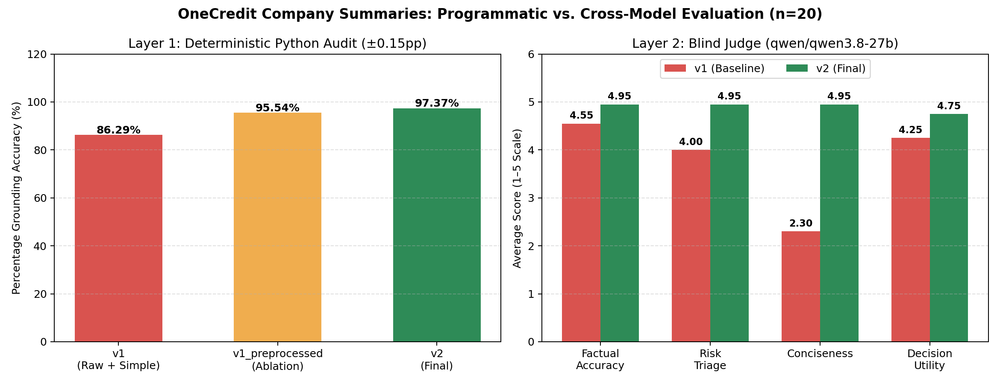

# Case Study: Automated Company Vetting Summaries

> **TL;DR:** Built and iterated a company vetting summarizer on a stratified 20-company sample (`n=20`) using Groq (`openai/gpt-oss-120b` generator; `qwen/qwen3.8-27b` blind cross-model judge). **Key finding:** Separating Python deterministic preprocessing from LLM synthesis (`v1 → v1_preprocessed → v2`) raised programmatic percentage grounding from **86.29% to 97.37%** (cutting input JSON characters by **63.6%**), while the risk-first bullet template eliminated narrow-UI table wrapping (**20/20 → 0/20**) and surfaced `Winding up` flags in the first 35 words (**0/2 → 2/2**). Under a fair raw-JSON blind judge, `v2` was preferred on **19/20** companies—and the 1 loss (`SYN-001569`) surfaced a real feature-selection trade-off (dropping DSCR). **Main limitation:** Risk-tier calibration is overly conservative (16 Medium, 0 Low) and lacks human analyst labels.

---

## 1. What a good summary is for this team, and why

### Business Context
The end users are a vetting team evaluating companies before onboarding them as **suppliers or project partners**. They do not need a full accounting report—they need a **fast, trustworthy first-pass screening brief** (readable in **under 1 minute**) to answer one core question: *"Which companies deserve a closer look, and why?"*

*(Note: These quality criteria are inferred from the problem statement and dataset rather than interviews with an actual vetting team.)*

### Data Exploration Findings (`explore.py`, saved in `eda_summary.json`)
Before designing the summarization system, I profiled all **50 synthetic companies** in `data/companies.jsonl` (records as of 31 Dec 2025) to understand the data distribution and edge cases:

- **Company Status (Major Red Flags):** 48 companies are `Active`, while **2 companies are `Winding up`** (`SYN-000545` and `SYN-001212`, both with 8 court cases). For a vetting team, a winding-up status is a major red flag that must be surfaced at the very top of the summary.
- **Financial Data Completeness (Edge Cases):**
  - 38 companies have 3 years of financial statements.
  - 4 companies have 2 years, and 5 companies have only 1 year.
  - **3 companies have 0 years of financial data** (`SYN-000302`, `SYN-000333`, `SYN-001203`), with `SYN-001203` also carrying a court case.
  - *Implication:* A rigid prompt asking for a "3-year trend" risks causing hallucinations on 0- or 1-year companies. The system must explicitly flag missing financials as a transparency gap.
- **Litigation Exposure:** **18 out of 50 companies (36%)** have court cases (ranging from 1 to 8 cases). Missing a defendant litigation record is far more costly than omitting minor operational details.
- **Industry Diversity:** Covers 11 industries (led by Hospitality, Food & Beverage, and Retail), with raw records averaging ~2,000+ tokens due to 24 statement line items and 4 nested ratio groups per year.

### Definition of a "Good" Summary
Based on the business goal and dataset realities above, a good summary for this team must satisfy **5 criteria**:
1. **Risk-First Triage:** Surface major red flags (`Winding up`, defendant lawsuits, negative equity, non-unqualified audits, missing financials) immediately—never bury them at the bottom.
2. **Strict Factual Grounding (Zero Hallucination):** Every RM figure, percentage, date, and case detail must match the source JSON accurately. When data is missing, state it explicitly.
3. **UI-Friendly Structure:** Clean, consistent Markdown bullet sections that render cleanly inside the narrow Viewer card without broken multi-column tables.
4. **Conciseness & Signal-to-Noise:** Distill 2,000+ tokens of raw filings into a scannable brief (~180–250 words, readable in under 1 minute).
5. **Actionable Context:** Distinguish *plaintiff* vs. *defendant* in court cases, and highlight financial direction rather than dumping raw tables.

---

## 2. What you built

### Sampling Strategy (Stratified 20-Company Sample, `n=20`)
Because Groq's free tier for `openai/gpt-oss-120b` enforces a strict **8,000 TPM** (tokens per minute) cap, I evaluated a **stratified sample of 20 companies** rather than running all 50 blindly, ensuring 100% coverage of every critical edge case discovered in EDA:
- **2 / 2 `Winding up` companies** (`SYN-000545`, `SYN-001212`) — top-line red-flag triage test.
- **3 / 3 `0-year financial` companies** (`SYN-000302`, `SYN-000333`, `SYN-001203`) — missing-data honesty test.
- **2 single-year financial companies** (`SYN-000802`, `SYN-001158`) — non-trend handling test.
- **6 active litigation companies** (`SYN-000165`, `SYN-000267`, `SYN-000286`, `SYN-000397`, `SYN-000640`, `SYN-001389`) — spanning 1 to 8 cases across Plaintiff and Defendant roles.
- **7 active, 0-case companies** (`SYN-000029`, `SYN-000067`, `SYN-000148`, `SYN-000476`, `SYN-000546`, `SYN-001455`, `SYN-001569`) — spanning both healthy and financially distressed firms across 7 industries.

### Model & Infrastructure Choices
- **Initial API Exploration:** Tested Google AI Studio (`gemini-flash-latest`), which revealed two practical constraints: internal reasoning tokens consumed `maxOutputTokens` (causing mid-sentence truncation until raised to 4096), and the free daily request cap (RPD) was exhausted during retries.
- **Primary Generator:** Switched to **Groq (`openai/gpt-oss-120b`)** via its OpenAI-compatible REST endpoint (`temperature=0.2`). Live response headers confirmed a **1,000 RPD** cap and **8,000 TPM** ceiling.
- **Pipeline Reliability & Response Caching (`generate_summary.py`):** Implemented `retry-after` backoff for HTTP `429`/`503`, empty-response guards, and idempotent resume. Every generated output and evaluation artifact is persisted to disk (`summaries/v1.jsonl`, `summaries/v2.jsonl`, `experiments/v1_preprocessed.jsonl`, `eval_results.json`, `numeric_audit_results.json`) so re-scoring requires zero extra API calls.

### Version 1 (`summaries/v1.jsonl`) — Naive Baseline & Error Analysis
For `v1`, I passed the **raw company JSON** with a simple unstructured procurement prompt. Auditing all 20 `v1` outputs revealed **4 concrete failure modes**:
1. **Arithmetic & Ratio Hallucinations:**
   - `SYN-001212`: Misread decimal net profit margins by 10×–100× (`0.58%`, `0.03%`, `0.01%` instead of true `5.81%`, `2.65%`, `0.85%`).
   - `SYN-000029`: Confused 2-year total revenue growth (`+4.3%`) with annualized growth, reporting `~4% CAGR` (true CAGR is `~2.15%`).
   - `SYN-000545`: Mis-summed pending court claims as `~RM 2.9M` (true sum: `RM 2.50M`) and misstated leverage as `Liabilities / Assets` instead of `Liabilities / Equity`.
   - `SYN-001389`: Claimed two winding-up petitions were pending when only one (`CASE-2024-5611`) was pending and the 2025 petition was withdrawn.
2. **Plaintiff vs. Defendant Role Confusion:**
   - `SYN-000640`: 5 of 6 court cases list the company as **Plaintiff** (recovering debt owed *to* them), with only 1 Defendant judgment (`RM 310.6k`). `v1` lumped all judgments together (`> RM 2.8M`) as "material contingent liabilities."
3. **Temporal Grounding Hallucination:**
   - Without injecting the dataset's cutoff date (`31 December 2025`), `v1` falsely flagged legitimate 2024–2025 director appointments in `SYN-000067` and `SYN-001158` as *"future dates / possible data entry errors."*
4. **Poor Scanability, Broken UI Tables & Token Bottlenecks:**
   - Averaged **606.2 words** with wide Markdown tables in **20/20** summaries that broke across lines in the narrow Viewer card, burying `Winding up` statuses inside profile tables.

### Ablation (`experiments/v1_preprocessed.jsonl`) & Version 2 (`summaries/v2.jsonl`)
Because `v2` changed both the **input representation** and the **prompt template**, I ran an intermediate ablation (`v1_preprocessed`: deterministic Python preprocessing + `v1`'s simple prompt) to isolate which change drove which improvement:

1. **Deterministic Preprocessing (`preprocess_company` in `generate_summary.py`):**
   - Extracts high-signal vetting fields, cutting input **JSON character count by 63.6%** (token proxy).
   - Pre-computes exact net profit margins (`%`), multi-year revenue deltas, and non-unqualified audit warnings in Python so the LLM never performs arithmetic.
   - Strictly separates `as_defendant` (true liability exposure) vs. `as_plaintiff` (informational only), and injects `data_as_of_date: "2025-12-31"`.
   - *QA Catch during Iteration:* Inspecting the first `v2` draft caught a schema-key bug—litigation type was stored under `caseType` rather than `type`. Fixing this immediately surfaced the pending RM 355,900 winding-up petition in `SYN-000286`.
2. **Risk-First, UI-Aware Bullet Template (`v2`):**
   - Enforces a concise 4-section bullet layout (~180–250 words, zero Markdown tables) starting with a top-line Risk Verdict.

---

## 3. How you know whether it's good

I evaluated `v1`, `v1_preprocessed` (ablation), and `v2` on the 20 sampled companies (`n=20`) using **two complementary quantitative layers** plus side-by-side Viewer inspection (`http://localhost:8000`):

*Figure 1: Left — deterministic percentage grounding accuracy measured by `check_numbers.py` across `v1`, `v1_preprocessed`, and `v2`. Right — blind pairwise scores from `evaluate.py` (`qwen/qwen3.8-27b`, raw JSON ground truth).*

### 1. Layer 1 — Programmatic Numeric Grounding & Ablation Audit (`check_numbers.py`, 0 API calls)
Rather than relying solely on an LLM judge for Criterion #2 (factual accuracy), I wrote a deterministic script that extracts every percentage (`X.XX%`) from each summary and verifies it against all mathematically valid percentages derivable from the raw JSON (shareholder stakes/sums, financial ratios × 100, and multi-year statement changes) within a strict **±0.15 percentage-point tolerance** (saved in `numeric_audit_results.json`):

| Metric (`n=20` sampled companies) | `v1` (Raw + Simple) | `v1_preprocessed` (Ablation) | `v2` (Preprocessed + Template) |
|---|---:|---:|---:|
| **Input JSON Character Size** | Baseline (100%) | **-63.6% smaller** | **-63.6% smaller** |
| **Total Percentages Cited** | 248 | 157 | 114 |
| **Unmatched Percentages (±0.15pp)** | **34** (14/20 cos.) | **7** (6/20 cos.) | **3** (3/20 cos.) |
| **Programmatic % Grounding Accuracy** | 86.29% | **95.54%** (+9.25pp) | **97.37%** (+11.08pp) |
| **Temporal Hallucination False Alarms** | 2 | **0** | **0** |
| **Contains Markdown Table (breaks narrow UI)** | 20/20 | 20/20 | **0/20** |
| **Average Word Count** | 606.2 words | ~490 words | **217.4 words** |
| **`Winding up` Surfaced in First 35 Words** | 0/2 | 0/2 | **2/2** |
| **Winding-Up Petition / Audit / 0-Yr Recall** | 4/4 · 2/2 · 3/3 | 4/4 · 2/2 · 3/3 | **4/4 · 2/2 · 3/3** |

**What the Ablation Proves:**
- **Preprocessing (`v1 → v1_preprocessed`) drove factual accuracy:** Programmatic percentage grounding jumped from **86.29% → 95.54%**, immediately eliminating `SYN-001212`'s `0.58%/0.03%/0.01%` error, `SYN-000029`'s `4% CAGR` error, `SYN-000640`'s Plaintiff/Defendant confusion, and temporal hallucinations. However, `v1_preprocessed` still generated wide Markdown tables (20/20) that collapsed vertically in the Viewer and buried `Winding up` statuses.
- **The Risk-First Bullet Template (`v1_preprocessed → v2`) drove usability & triage:** Eliminated broken tables (**20/20 → 0/20**), cut length to **217.4 words**, and surfaced `Winding up` within the first 35 words (**2/2**). All 3 remaining unmatched percentages in `v2` were inspected manually and confirmed to be benign rounding/aggregations (`≈90%` for `89.67%` in `SYN-000267`, `30%` director sum in `SYN-001203`, and `99%` rounding for `100%` in `SYN-001569`).

*(Note: I intentionally do not use "format compliance" or "≤300 words" as competitive metrics against `v1`, since `v1`'s prompt did not instruct those constraints.)*

### 2. Layer 2 — Blind Cross-Model LLM-as-a-Judge (`evaluate.py`, `qwen/qwen3.8-27b`, `n=20`)
To complement programmatic checks with qualitative scoring while avoiding self-enhancement bias, I used a **different model family** (`qwen/qwen3.8-27b` judging `openai/gpt-oss-120b` at `temperature=0.0`) with **alternating A/B ordering** to mitigate position bias. Crucially, the judge was given the **full raw JSON** (not the preprocessed payload) so `v1` was never unfairly penalized for citing valid fields dropped during preprocessing (saved in `eval_results.json`):

| Rubric Dimension (1–5 Scale, `n=20`, Raw JSON Ground Truth) | `v1` Avg | `v2` Avg |
|---|---:|---:|
| **Factual Accuracy & No Hallucination** | 4.55 | **4.95** |
| **Risk Triage & Red-Flag Recall** | 4.00 | **4.95** |
| **Conciseness & Scanability** | 2.30 | **4.95** |
| **Decision Utility** | 4.25 | **4.75** |
| **Blind Pairwise Preference (`n=20`)** | 1 / 20 | **19 / 20** |

The independent judge model preferred `v2` over `v1` on **19/20** sampled companies. **Importantly, the single case where `v1` beat `v2` (`SYN-001569`) uncovered a real feature-selection trade-off:** our `preprocess_company()` filter dropped `debtServiceCoverageRatio` (DSCR) to save tokens, causing `v2` to miss a sub-1.0 DSCR warning (`0.83×` / `0.73×`) that `v1` surfaced from the raw JSON. Retaining DSCR in `preprocess_company()` is an immediate, evidence-backed `v3` improvement.

### Honest Limitations of This Evaluation
- **Feature-Selection Trade-Off (`SYN-001569`):** Compressing raw JSON by 63.6% eliminated arithmetic hallucinations and TPM bottlenecks, but risked dropping secondary ratios (like DSCR) when they turn critical.
- **No Human Analyst Labels Yet:** Even with raw-JSON grounding and cross-model blind judging, an LLM judge cannot replace a **human-labeled golden set** scored by actual OneCredit credit analysts.
- **Risk-Tier Calibration & Role Tension:** Inspecting `v2` verdicts revealed **4 `🔴 HIGH RISK`**, **16 `🟡 MEDIUM RISK`**, and **0 `🟢 LOW RISK`** ratings—the LLM is overly conservative and lacks discrimination. Letting an LLM freely assign `HIGH / MEDIUM / LOW` blurs the line between **triage support** and **making the credit decision for the human**; risk tiers should be computed deterministically in Python so they are transparent and auditable.

---

## 4. What you'd do next, and how you'd keep improving it

1. **Deterministic, Auditable Risk-Tier Rules & `v3` Feature Refinements:**
   - Add `debtServiceCoverageRatio` (DSCR) and `netWorkingCapital` back into `preprocess_company()` (addressing the `SYN-001569` trade-off).
   - Partner with the vetting team to define explicit Python rules for risk tiers (e.g., `Winding up` or pending winding-up petition = `HIGH`; clean litigation + positive FCF + quick ratio > 1.2 + leverage < 1.0 = `LOW`), leaving the LLM strictly responsible for clear narrative explanation.
2. **Scale `v2` to All 50 Companies & Production Observability:**
   - Because `v2`'s preprocessed payload is 63.6% smaller, run `v2` across the remaining 30 companies cleanly within free-tier limits, and in production track prompt versions, latency, and token cost via **MLflow** or **Langfuse**.
3. **Expand Programmatic Guardrails (RM Amounts + CSS Fallback):**
   - Extend `check_numbers.py` to also verify every RM monetary figure against the source JSON as a pre-serve guardrail, and add `overflow-x: auto` CSS in `app/static/index.html` as a defensive fallback for any future tabular output.
4. **Human-in-the-Loop Golden Set & Feedback Loop:**
   - Have analysts score a 20-company golden set to measure judge-to-human agreement (Cohen's kappa) and add lightweight thumbs-up/down + reason tags (*"missed risk"*, *"wrong figure"*, *"too verbose"*) in the UI to drive ongoing prompt iterations.

---

### Repository Guide (Key Files)
| File | Purpose |
|---|---|
| `explore.py` / `eda_summary.json` | Profiles all 50 companies in `data/companies.jsonl` (status, financial years, litigation, schema). |
| `generate_summary.py` | Main pipeline generating `v1` (raw baseline), `v1_preprocessed` (ablation), and `v2` (final risk-first system) via Groq. |
| `summaries/v1.jsonl` & `summaries/v2.jsonl` | Generated Markdown summaries for the 20 sampled companies (viewable side-by-side in the local Docker Viewer). |
| `experiments/v1_preprocessed.jsonl` | Intermediate ablation output (preprocessed data + `v1` prompt) isolating preprocessing vs. prompt gains. |
| `check_numbers.py` / `numeric_audit_results.json` | Deterministic Python audit verifying all cited percentages against the raw JSON (`±0.15pp`). |
| `evaluate.py` / `eval_results.json` | Blind cross-model LLM-as-a-Judge (`qwen/qwen3.8-27b`) comparing `v1` vs. `v2` against raw JSON ground truth. |
| `plot_eval.py` / `eval_comparison.png` | Dynamically generates the 2-panel comparison chart from the JSON audit and evaluation artifacts. |

### How to Reproduce
1. Create a local `.env` file (gitignored — never committed) with your Groq key: `GROQ_API_KEY=your_key_here`
2. Install dependencies: `pip install requests python-dotenv matplotlib`
3. Run the scripts in order:
   - `python explore.py` → outputs dataset profile (`eda_summary.json`)
   - `python generate_summary.py v1` / `v1_preprocessed` / `v2` → generates summaries (`summaries/<version>.jsonl`)
   - `python check_numbers.py` → runs deterministic percentage grounding audit (`numeric_audit_results.json`)
   - `python evaluate.py` → runs blind cross-model judge against raw JSON (`eval_results.json`)
   - `python plot_eval.py` → generates `eval_comparison.png`

### Disclosure of AI Tools & Models Used
- **LLM APIs:**
  - **Groq (`openai/gpt-oss-120b`)** — Primary generator for `v1`, `v1_preprocessed`, and `v2`.
  - **Groq (`qwen/qwen3.8-27b`)** — Independent cross-model judge in `evaluate.py` (model ID verified via Groq's `/openai/v1/models` endpoint).
  - **Google AI Studio (`gemini-flash-latest`)** — Tested during initial prototyping before switching to Groq due to daily quota and thinking-token truncation constraints.
- **How I Used AI Assistants (Antigravity / Gemini & Claude):**
  - **Model Selection & Architecture:** Consulted both **Antigravity (Gemini)** and **Claude** to compare free-tier LLM options, plan rate-limit budgets, and design the cross-model evaluation strategy.
  - **Guided Step-by-Step Implementation (No Blind "Vibe Coding"):** Rather than copy-pasting entire codebases blindly, I used Antigravity as a step-by-step pair-programming tutor—making targeted edits myself and walking through every bug (e.g., HTTP 429/503 retries, `caseType` schema mismatch, and `maxOutputTokens` truncation) so I fully understand every line of code.
  - **Independent Review & Manual Checking (~2 Hours):** I used the last ~2 hours to review and verify my work. I asked **Claude** to critique my draft results and case study, which helped me spot gaps and add the `v1_preprocessed` comparison and `check_numbers.py` script. When I read through `eval_results.json` myself, seeing `v2` win 20/20 while the judge kept accusing `v1` of hallucinations felt suspicious—so I checked the code, realized the judge wasn't seeing the full original JSON, and re-ran it fairly against the full company records.